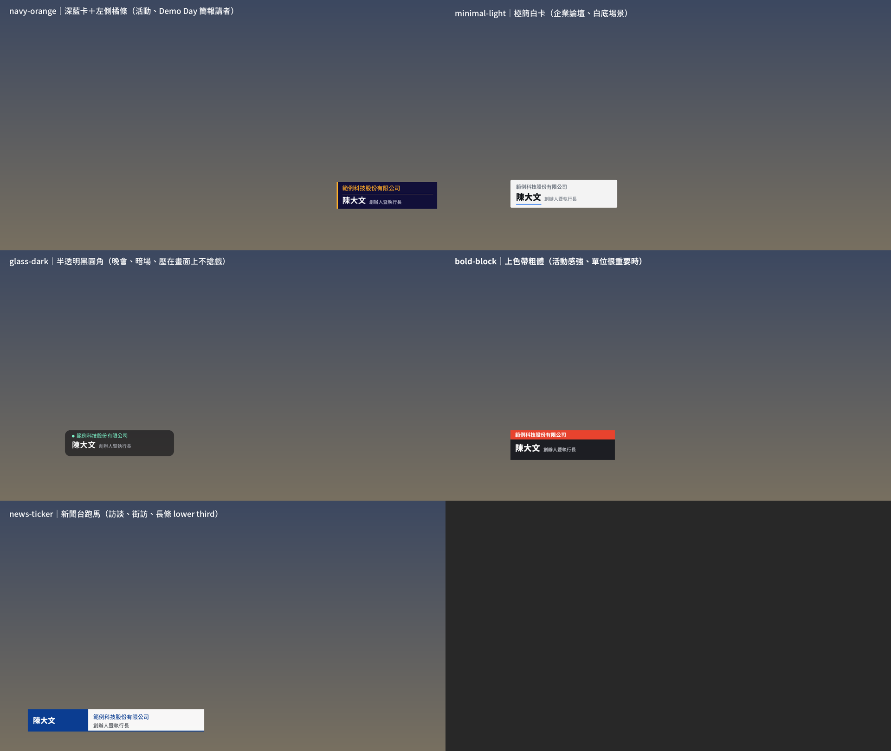

# 講者字卡產生器（namecard-generator）

活動、論壇、訪談影片用的講者字卡（lower third）。一位講者出一張透明 PNG，疊在剪輯軟體的畫面上方就對齊，不用一張張手排。



## 五個預設版型

| 版型 | 樣子 | 適合 | 預設位置 |
|---|---|---|---|
| `navy-orange` | 深藍卡＋左側橘條 | 活動、Demo Day 簡報講者 | 右下 |
| `minimal-light` | 白卡＋藍色底線 | 企業論壇、白底場景 | 左下 |
| `glass-dark` | 半透明黑圓角＋圓點 | 晚會、暗場，不搶畫面 | 左下 |
| `bold-block` | 上方色帶放單位，粗體 | 單位要突出的場合 | 左下 |
| `news-ticker` | 新聞台長條，左色塊放名字 | 訪談、街訪 | 左下長條 |

## 安裝

需要 Python 3 和 Pillow；裝了 fontTools 會多一道缺字檢查。

```bash
pip install pillow fonttools
```

字型檔不在這個 repo 裡，請自行安裝到系統字型，或放進 `fonts/` 資料夾。預設用到的都是免費開源字型：
源石黑體（GenSekiGothic2）、思源黑體（Noto Sans CJK TC）、源泉圓體（GenSenRounded2）。對應檔名寫在 `fonts.json`。

## 用法

```bash
python3 namecard_gen.py --list                     # 看有哪些版型與字體
python3 namecard_gen.py --demo                     # 五個版型各出一張，拼成 preview/presets.png
python3 namecard_gen.py sample.csv out/ --preset glass-dark
python3 namecard_gen.py --org 範例科技 --name 陳大文 --title 執行長 out/ --preset news-ticker
python3 namecard_gen.py sample.csv out/ --preset minimal-light --accent '#E8432E' --font genseki --canvas 3840x2160
```

名單 CSV 欄位：`序,類別,單位,姓名,職稱`，可以再加一欄 `版位` 逐列指定位置。姓名留空就只印單位。
輸出檔名：`字卡_講者名卡{類別}{姓名}_{序}_{日期}_v{版}.png`，可用 `--prefix`、`--date`、`--ver` 改。

## 可以調的地方

- **顏色**：`--accent`、`--bg`、`--org-color`、`--name-color`、`--title-color`、`--rule-color`，格式 `#RRGGBB`，要半透明用 `#RRGGBBAA`
- **字體**：`--font` 填 `fonts.json` 的家族名，或直接給字型檔路徑
- **字級**：`--text-scale 0.9` 整體縮放
- **位置**：`--pos pitch｜lower-third｜lower-third-wide｜center-bottom`，或 `x,y`（以 1920×1080 為基準）
- **畫布**：`--canvas 3840x2160` 出 4K，版面會等比放大

## 缺字檢查

出圖前會檢查名單上每個字，三個字重都有才會繼續，缺字就停下並列出是哪幾個字；加 `--allow-missing` 才會照出。
日文字型常缺台灣常用字，例如「暨」，不檢查的話會印出方塊。

## 加自己的版型

在 `presets.json` 複製一段、改名、改顏色和尺寸就好，不用動程式。
`layout` 有五種：`bar`（左色條）、`underline`（名字底線）、`pill`（圓角加圓點）、`block`（上色帶）、`ticker`（左色塊放名字）。
